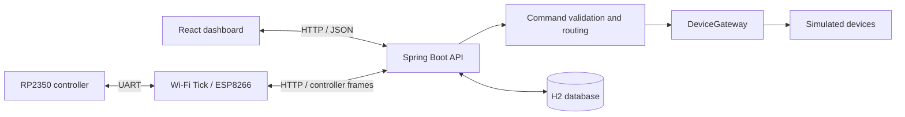

<p align="center">
  
</p>

# Smart Home

A local home automation application with a React dashboard, a Spring Boot API and a wireless RP2350 controller. Configure devices, map commands to actions, inspect execution results and monitor the controller from one workspace.

The current implementation includes a working Wi-Fi Tick connection and simulated lights, plugs, doors and windows. Voice recognition has a defined firmware interface; a trained model is not included yet. Commands can already be tested through the dashboard or the controller's physical buttons.

[Getting started](#getting-started) · [Wireless controller](#wireless-controller) · [API](#api) · [Testing](#testing-and-delivery)

## Features

- **Device management:** create, edit and organize devices by room, with controls appropriate to each device type.
- **Command mappings:** associate a recognized command with a target device and an explicit action.
- **Execution feedback:** distinguish confirmed results, rejected commands, failures and unconfirmed execution.
- **Activity and notifications:** inspect command history, mark notifications as read and export activity as CSV.
- **Controller monitoring:** view wireless connectivity, server acknowledgements, signal strength, module address and the last reported board screen.
- **Diagnostics:** submit recognition results with a configurable confidence value and exercise simulated device behavior.
- **Local persistence:** retain device configuration, mappings, command events and notification read state in an embedded H2 database.

## Architecture



The backend validates commands, checks confidence and resolves the configured device before calling the device gateway. Requested state and reported state are tracked separately. Sending a message alone does not count as a confirmed action.

The controller sends command and status frames through the Wi-Fi Tick. The dashboard displays the screen state reported by the board and marks an older screen as **Last received** when live updates are unavailable.

| Component             | Technologies                                                            |
| --------------------- | ----------------------------------------------------------------------- |
| Web interface         | React 19, TypeScript, Vite, Lucide icons                                |
| API and control logic | Java 21, Spring Boot 4, Spring MVC                                      |
| Storage               | Embedded H2 database, JDBC                                              |
| Controller firmware   | C++17, RP2350, YAHAL, uGUI, CMake                                       |
| Wireless bridge       | ESP8266, Arduino core, HTTP                                             |
| Verification          | Vitest, Testing Library, JUnit, MockMvc, JaCoCo, CTest, Python unittest |

## Getting started

### Requirements

- Java 21 JDK and Maven.
- Node.js 22.13 or later in the 22.x release line, or Node.js 24 or later, with npm.
- Git and Bash.

Hardware tools are only needed for the optional controller setup below. Run commands from the repository root unless another directory is specified.

### Build and run

```bash
git clone https://github.com/zaka41a/Voice-Controlled-Smart-Home-System.git
cd Voice-Controlled-Smart-Home-System
bash scripts/start.sh
```

The startup script installs frontend dependencies, runs the application checks, builds the React interface into the Java application and starts the server.

Open **http://127.0.0.1:8080/**. A new workspace contains a light, a door and a window with the six default command mappings. No physical device is required to use this mode.

To start the existing build again without rebuilding:

```bash
(cd backend && java -jar target/voicehome.jar)
```

Stop the server with `Ctrl+C`. Keep the working directory consistent so subsequent starts use the same local database.

### First command

1. Open **Devices** to inspect the configured devices.
2. Open **Commands** to review their mappings.
3. Open **Diagnostics**, select `LIGHT_ON`, use a confidence above the displayed threshold and send the command.
4. Check the device state and the corresponding entry in **Activity**.

The default acceptance threshold is `0.80`. A low-confidence command is rejected before device execution.

## Local development

Run the backend in one terminal:

```bash
mvn -f backend/pom.xml spring-boot:run
```

Run the frontend in a second terminal:

```bash
cd frontend
npm ci
npm run dev
```

Use the URL printed by Vite, normally **http://127.0.0.1:5173/**. Its development server forwards `/api` requests to the backend on port `8080`.

For a complete build with the frontend packaged inside the backend:

```bash
bash scripts/check.sh
```

Restart the packaged server after rebuilding it. The Vite development server is the convenient option for frequent interface changes.

## Commands and device behavior

| Command        | Compatible device | Action   |
| -------------- | ----------------- | -------- |
| `DOOR_OPEN`    | Door              | Open     |
| `DOOR_CLOSE`   | Door              | Close    |
| `WINDOW_OPEN`  | Window            | Open     |
| `WINDOW_CLOSE` | Window            | Close    |
| `LIGHT_ON`     | Light or plug     | Turn on  |
| `LIGHT_OFF`    | Light or plug     | Turn off |

Device configuration supports three simulation behaviors:

| Behavior      | Result                                                       |
| ------------- | ------------------------------------------------------------ |
| `CONFIRMED`   | Execute the simulated action and report the resulting state. |
| `UNCONFIRMED` | Accept the action without claiming a confirmed device state. |
| `OFFLINE`     | Report the device as unavailable and fail the action.        |

Command outcomes are `CONFIRMED`, `REJECTED`, `FAILED` or `UNCONFIRMED`. Device state can be `UNKNOWN` when no current observation is available.

## Wireless controller

### Hardware and tools

The controller uses an **RP2350 LaunchPad**, a **BOOSTXL-EDUMKII** display and controls, and a **Wi-Fi Tick with an ESP8266**. The setup has been exercised with LaunchPad revision **1.1**; the build also accepts revision `1.0`. Always select the revision printed on the board.

Install the following tools before building firmware:

- Python 3.
- CMake 3.20 or later and a native C++ compiler for host tests.
- Arm GNU Toolchain with `arm-none-eabi-gcc` available on `PATH`.
- OpenOCD with RP2350 support and access to the CMSIS-DAP debug probe.
- Arduino CLI with the ESP8266 core and board target `esp8266:esp8266:generic` installed.
- A YAHAL checkout containing support for the RP2350 LaunchPad and uGUI.

Set the library path in the terminal used for firmware commands:

```bash
export YAHAL_DIR="/absolute/path/to/YAHAL"
```

The flashing helper uses POSIX serial APIs. The hardware workflow has been exercised on macOS.

### Configure and install

Connect the computer and Wi-Fi Tick to the same reachable **2.4 GHz network**. Keep the board connected to the computer through its debug USB port while programming it. Disconnect power before changing the module's placement or orientation.

Generate the local configuration:

```bash
python3 scripts/configure-controller.py --revision 1.1
```

The script asks for the network name and a hidden password, generates a controller key and detects the computer's LAN address on macOS. Use `--host <LAN_IP>` when automatic detection is unavailable or selects the wrong interface.

The generated configuration files are excluded from Git:

- `firmware/controller.local.json`
- `firmware/wifi_tick/controller_config.h`

Build without programming hardware:

```bash
bash scripts/build-controller.sh 1.1
```

Install and verify both firmware images:

```bash
python3 scripts/flash-controller.py --revision 1.1
```

Start the backend with the controller connection enabled:

```bash
python3 scripts/start-controller.py
```

Open **http://127.0.0.1:8081/#controller** on the server computer. The page reports the wireless link, the board's acknowledgement, the latest display and model availability. Device actions still use the simulator in this mode.

For later RP2350-only updates:

```bash
python3 scripts/flash-controller.py --revision 1.1 --board-only
```

This preserves the installed Wi-Fi Tick firmware. Changes to the Wi-Fi network, backend address or controller key require regenerating the configuration and installing the Wi-Fi Tick firmware again.

### Physical controls

| Control         | Function                       |
| --------------- | ------------------------------ |
| S1              | Enter or leave listening mode. |
| S2              | Select the next command.       |
| Joystick button | Send the selected command.     |

Microphone level is a signal measurement, not recognition confidence. Sound alone does not activate listening mode.

### Recognition integration

The firmware captures signed 16-bit PCM in blocks of 256 samples at 16 kHz. A model adapter implements the functions declared in [`recognition.h`](firmware/rp2350/src/recognition.h):

- `home_recognizer_ready()`
- `home_recognizer_process(...)`
- `home_recognizer_reset()`

Command indices follow [`home::Commands`](firmware/shared/controller_state.h), and firmware confidence values use the range `0..1000`. Adapter sources can be included through the CMake setting `HOME_MODEL_SOURCES`.

The supplied adapter reports the model as unavailable. The dashboard therefore shows **Not loaded** until a model implementation is connected.

## Configuration and storage

| Setting                        | Purpose                                                                       | Default                                                  |
| ------------------------------ | ----------------------------------------------------------------------------- | -------------------------------------------------------- |
| `VOICEHOME_MINIMUM_CONFIDENCE` | Command acceptance threshold, from `0` to `1`.                                | `0.80`                                                   |
| `VOICEHOME_CONFIG_FILE`        | Legacy JSON configuration path, imported into an empty database when present. | `data/configuration.json`                                |
| `VOICEHOME_DATABASE_FILE`      | H2 database base path, without the `.mv.db` suffix.                           | `voicehome` beside the configured JSON path              |
| `VOICEHOME_CONTROLLER_PORT`    | HTTP port with the `hardware` profile enabled.                                | `8081`                                                   |
| `VOICEHOME_CONTROLLER_KEY`     | Shared key for controller exchanges.                                          | Loaded by `start-controller.py` from local configuration |

The standard startup scripts use `backend/data/` for workspace data. Configuration, mappings, history and notification read state persist across restarts. Historical command results are not restored as fresh observations of a physical device.

The default server listens on loopback. The `hardware` profile listens on the network so the Wi-Fi Tick can reach it. Workspace API routes remain restricted to the server computer; the controller exchange endpoint requires `X-Controller-Key`.

The current controller transport uses HTTP on the local network. It does not include TLS or a user account system. Keep generated configuration and firmware containing Wi-Fi credentials out of published artifacts.

## API

The backend serves the packaged frontend and API from the same origin.

| Method                 | Endpoint                    | Purpose                                                 |
| ---------------------- | --------------------------- | ------------------------------------------------------- |
| `GET`                  | `/api/dashboard`            | Devices, mappings, recent events and settings.          |
| `GET`                  | `/api/devices`              | List devices.                                           |
| `GET`, `PUT`, `DELETE` | `/api/devices/{id}`         | Read, configure or remove a device.                     |
| `GET`                  | `/api/mappings`             | List command mappings.                                  |
| `PUT`, `DELETE`        | `/api/mappings/{commandId}` | Configure or remove a mapping.                          |
| `POST`                 | `/api/commands`             | Submit a command ID and confidence.                     |
| `POST`                 | `/api/notifications/read`   | Mark event IDs as read.                                 |
| `GET`                  | `/api/controller/status`    | Connection, display and controller telemetry.           |
| `POST`                 | `/api/controller/exchange`  | Exchange authenticated text frames with the controller. |

Submit a command to the local simulation server:

```bash
curl --request POST http://127.0.0.1:8080/api/commands \
  --header 'Content-Type: application/json' \
  --data '{"commandId":"LIGHT_ON","confidence":0.95}'
```

JSON command confidence uses the range `0..1`. Responses include the outcome, requested state, reported state, processing duration and an explanatory message. Validation errors return structured JSON with field details where applicable.

## Testing and delivery

Run the application checks:

```bash
bash scripts/check.sh
```

This runs frontend formatting, linting, type checks and tests, builds the interface, then runs Maven verification. JaCoCo enforces a minimum backend line coverage of 80%.

Additional checks:

```bash
bash scripts/check-firmware.sh
python3 -m unittest discover -s scripts/tests
python3 scripts/smoke_test.py backend/target/voicehome.jar
```

Firmware tests cover protocol handling, controller state, programmer diagnostics and microphone level. Display rendering tests also run when YAHAL is available. The HTTP smoke test starts an isolated server and checks the packaged interface, commands and persistence across a restart.

The [GitHub Actions workflow](.github/workflows/ci.yml) runs verification for pull requests and pushes to `main`. Successful `main` builds publish an application archive and SHA-256 checksum as workflow artifacts, alongside test reports.

Create the application archive locally after verification:

```bash
bash scripts/package.sh
```

The output is `dist/home-control.tar.gz` and its `.sha256` file. The extracted application requires Java 21 and includes a `start.sh` launcher.

## Repository layout

```text
backend/          Spring Boot API, command handling, storage and integration tests
frontend/         React interface, assets and component tests
firmware/
  rp2350/         Controller firmware, display and recognition interface
  wifi_tick/      ESP8266 wireless bridge
  shared/         Protocol, controller state and shared display artwork
  tests/          Native firmware tests
scripts/          Build, startup, configuration, flashing and verification tools
.github/          Continuous integration and artifact delivery
```

## Troubleshooting

| Symptom                                          | Check                                                                                                                              |
| ------------------------------------------------ | ---------------------------------------------------------------------------------------------------------------------------------- |
| JavaScript or CSS returns `404` after an update  | Restart the packaged server and reload the page without its old cached HTML. Use Vite for frequent UI changes.                     |
| Port `8080` is already occupied                  | Stop the conflicting service or choose a different Spring Boot port. Update the Vite proxy when changing the development API port. |
| The controller shows **Server offline**          | Check the configured LAN address, the hardware-profile server, firewall access and reachability between Wi-Fi clients.             |
| The controller shows **Check server key**        | Verify that the server and installed Wi-Fi Tick firmware use the same generated configuration.                                     |
| The Wi-Fi Tick cannot be programmed              | Check the module orientation, board revision, debug connection and programmer diagnostics.                                         |
| The voice model shows **Not loaded**             | Integrate a model adapter. Button commands and simulated recognition remain available.                                             |
| The displayed screen is marked **Last received** | The previous report is retained, but the current board screen cannot be verified until fresh messages arrive.                      |
